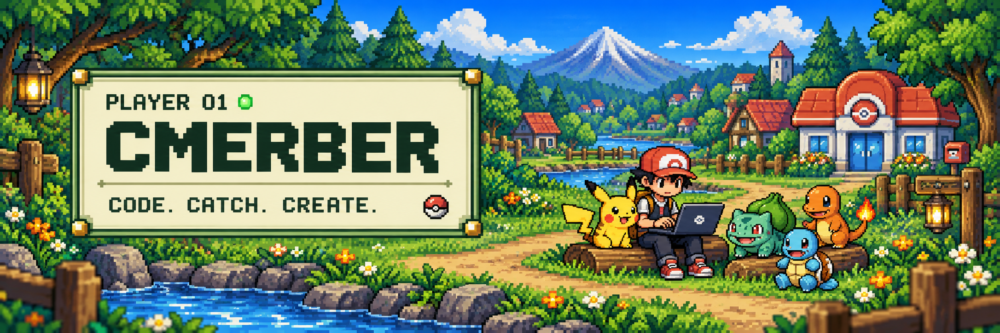
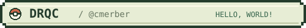
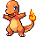
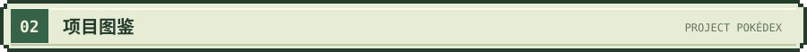
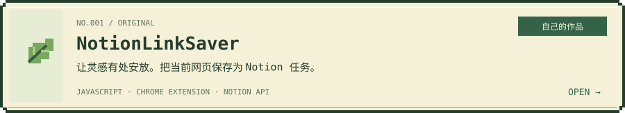
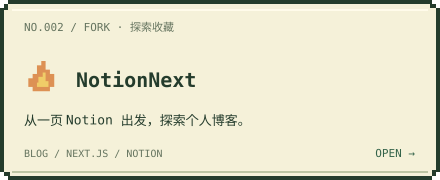
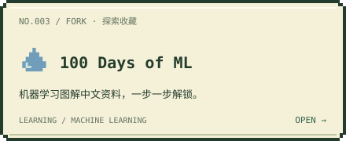
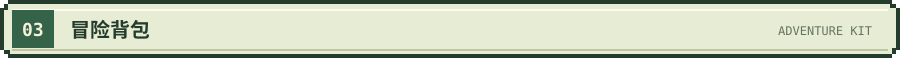
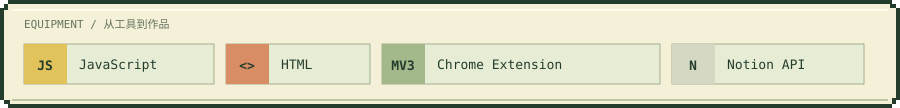
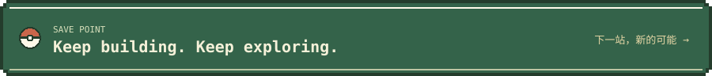

<!-- cmerber profile README · Pixel adventure edition -->
<!-- 静态与宝可梦动画素材在 assets/；贪吃蛇由 GitHub Actions 根据真实贡献生成到 output 分支。 -->

  

  

<b>伙伴小队 · PARTY READY</b>

  
  
  
  

  <b>把灵感收进背包，把想法写成作品。</b> 
  A little curiosity. A little code. A new adventure.

  
  
  
  

 

<table>
  <tr>
    <td width="50%" valign="top">
      <h3>👋 你好，我是 drqc</h3>
      
研究生 / 开发者，常驻成都。 这里存放我的工具、实验与学习记录。

      
<b>训练师 ID</b> · <a href="https://github.com/cmerber">@cmerber</a> <b>个人博客</b> · <a href="https://qcode.im/">qcode.im</a> <b>冒险方式</b> · 保持好奇，边做边学

    </td>
    <td width="50%" valign="top">
      <h3>🧭 我的探索地图</h3>
      
🌿 <b>实用工具</b> · 让重复的事简单一点 🔥 <b>个人博客</b> · 给知识和想法一个家 💧 <b>学习记录</b> · 把每一次探索变成积累

      
<i>每一个小项目，都是冒险的新起点。</i>

    </td>
  </tr>
</table>

 

  
  

  🌱 原创工具与探索收藏，一起组成我的冒险地图。<a href="https://github.com/cmerber?tab=repositories">查看全部仓库 →</a>

 

背包装下工具，作品记录旅程。

 

<b>每一次提交，都是一次经验积累。</b>

  <picture>
    <source media="(prefers-color-scheme: dark)" srcset="https://raw.githubusercontent.com/cmerber/cmerber/output/github-contribution-grid-snake-dark.svg" />
    <source media="(prefers-color-scheme: light)" srcset="https://raw.githubusercontent.com/cmerber/cmerber/output/github-contribution-grid-snake.svg" />
    
  </picture>

小蛇每天来收集补给 · 每日北京时间 10:23 计划刷新 · <a href="https://github.com/cmerber/cmerber/actions/workflows/snake.yml">查看更新状态 →</a>

 

Thanks for stopping by. See you on the next adventure! ✦

Pokémon sprites: <a href="https://github.com/PokeAPI/sprites">PokéAPI</a> · Contribution snake: <a href="https://github.com/Platane/snk">Platane/snk</a>

