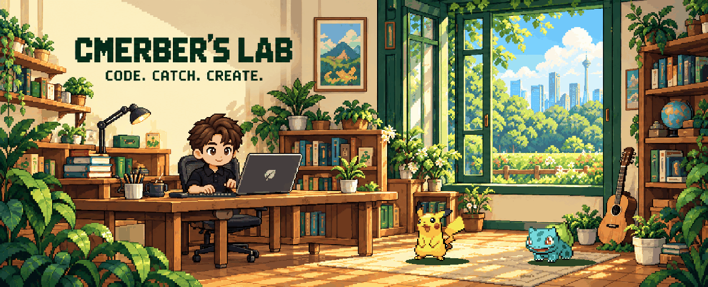
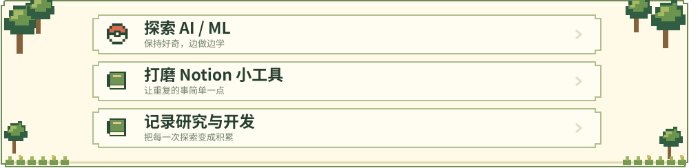
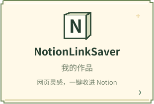
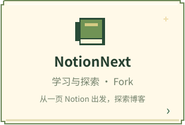
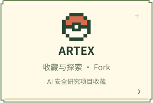
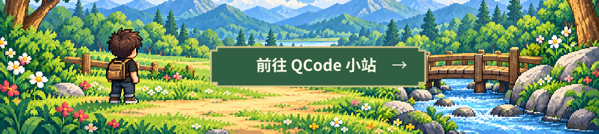

<!-- CMERBER'S LAB · Pixel research lab edition · 2026-10-26 -->
<!-- Original version: backup/pre-pixel-lab-2026-10-26 at e94e87916cc895f5929e64fe47ea5d176379e339 -->

  <picture>
    <source media="(prefers-reduced-motion: reduce)" srcset="./assets/lab/lab-poster.png" />
    
  </picture>

  <picture>
    <source media="(max-width: 600px)" srcset="./assets/lab/trainer-card-mobile.svg" />
    
  </picture>

把灵感收进背包，把想法写成作品。

<picture>
  <source media="(max-width: 600px)" srcset="./assets/lab/section-quests-mobile.svg" />
  
</picture>

<picture>
  <source media="(max-width: 600px)" srcset="./assets/lab/quests-mobile.svg" />
  
</picture>

 

<picture>
  <source media="(max-width: 600px)" srcset="./assets/lab/section-projects-mobile.svg" />
  
</picture>

  
  
  

  
  

 

<picture>
  <source media="(max-width: 600px)" srcset="./assets/lab/section-contributions-mobile.svg" />
  
</picture>

  <picture>
    <source media="(prefers-color-scheme: dark)" srcset="https://raw.githubusercontent.com/cmerber/cmerber/output/github-contribution-grid-snake-dark.svg" />
    <source media="(prefers-color-scheme: light)" srcset="https://raw.githubusercontent.com/cmerber/cmerber/output/github-contribution-grid-snake.svg" />
    
  </picture>

每一次提交，都是一次经验积累。每日北京时间 10:23 计划刷新 · <a href="https://github.com/cmerber/cmerber/actions/workflows/snake.yml">查看补给状态 →</a>

Pokémon sprites: <a href="https://github.com/PokeAPI/sprites">PokéAPI</a> · Contribution snake: <a href="https://github.com/Platane/snk">Platane/snk</a>

